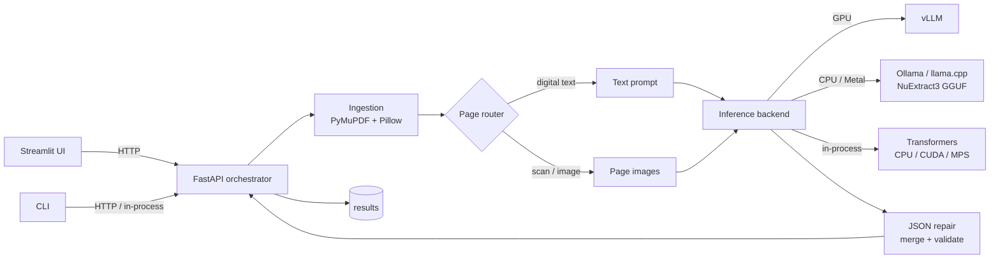

# NuExtract3 Studio

Document intelligence application built around **[numind/NuExtract3](https://huggingface.co/numind/NuExtract3)**:
a 4B vision-language model for **schema-guided extraction** and **document-to-Markdown**.
It handles digital PDFs, scans, photos, receipts, invoices, contracts and multi-page
documents through a single pipeline.

The project is intentionally structured like a production AI service rather than a
notebook: a stateless FastAPI orchestration layer, a separately deployed inference
server (vLLM on GPU, Ollama/llama.cpp on CPU), typed configuration, a template
registry, JSON repair and output validation, tests, evaluation tooling and a
Streamlit demonstrator. The same code runs on a GPU server and on a CPU-only
laptop — only the backend configuration changes.

## Features

- **Structured extraction** — PDF/image + JSON template → validated JSON.
- **Document-to-Markdown** — OCR/layout conversion for RAG preprocessing.
- **Template generation** — create a template from a natural-language description.
- **JSON Schema conversion** — reuse Pydantic / JSON Schema definitions.
- **Hybrid page routing** — native text for digital pages, vision for scanned pages.
- **Multi-page handling** — page-level chunking with recursive result merging.
- **Robust post-processing** — code-fence stripping, JSON repair, shape completion.
- **CPU and GPU backends** — vLLM (GPU), llama.cpp/Ollama GGUF (CPU/GPU),
  in-process Transformers (CPU/CUDA/MPS), all behind one interface.
- **Three interfaces** — FastAPI (OpenAPI docs), CLI, Streamlit demo.
- **Docker & deployment** — CPU and GPU images, Compose overlays, Kubernetes.
- **Evaluation harness** — tree-based field scoring on a JSONL golden set.

## Architecture



**Why a separate model server?** The model server owns the accelerator, batching,
KV-cache and model lifecycle. The API stays stateless, cheap to scale and easy to
test. With `provider=ollama` or `provider=transformers` the same API also runs on
machines without a GPU.

## Project structure

```text
.
├── src/nuextract_app/
│   ├── api/                  # FastAPI app, routes, schemas, dependencies
│   │   ├── main.py           # app factory, middleware, error handlers
│   │   └── routes/           # health, extract, markdown, templates
│   ├── core/
│   │   ├── document.py       # PDF/image ingestion, rendering, scan detection
│   │   ├── templates.py      # registry, JSON-Schema conversion, validation
│   │   ├── client.py         # vLLM, Ollama, llama.cpp, Transformers, auto
│   │   ├── runtime.py        # device/dtype detection (CPU, CUDA, MPS)
│   │   ├── pipeline.py       # routing, chunking, merging, orchestration
│   │   └── postprocess.py    # JSON repair, recursive merge, shape completion
│   ├── config.py             # pydantic-settings (env driven)
│   ├── logging.py            # request-scoped structured logs
│   └── cli.py                # `nuextract` Typer CLI
├── apps/streamlit/           # demonstrator (pure API client)
├── configs/templates/        # invoice, receipt, contract, id_card, bank_statement
├── docker/                   # Dockerfile.app + Dockerfile.cpu + Dockerfile.vllm
├── deploy/
│   ├── vllm/serve.sh         # production vLLM flags
│   └── kubernetes/           # Deployment/Service/HPA/PVC manifests
├── eval/                     # golden-set runner + tree metrics
├── tests/                    # unit + API tests (no GPU required)
├── scripts/                  # sample invoice, model download, smoke test
├── docs/                     # architecture, CPU guide, deployment, extraction
├── docker-compose.yml        # API + Streamlit (external vLLM)
├── docker-compose.gpu.yml    # adds vLLM (NVIDIA)
└── docker-compose.cpu.yml    # adds Ollama (CPU/Apple Metal)
```

## Quickstart

### Prerequisites

- Python **3.11 / 3.12**, [uv](https://docs.astral.sh/uv/)
- Docker (optional)
- One inference backend:
  - an NVIDIA GPU + vLLM (Linux), or a remote vLLM endpoint; **or**
  - [Ollama](https://ollama.com/download) for CPU / Apple Metal (recommended without a GPU); **or**
  - ~10 GB of free RAM for the in-process Transformers fallback

> vLLM does **not** run on macOS/Apple Silicon Docker. On a Mac, use native Ollama
> (Metal), the CPU Docker stack, or a remote GPU endpoint.

### 1. Install

```bash
cp .env.example .env
uv sync                       # add --extra local (GPU/MPS) or --extra cpu (CPU-only)
```

### 2. Start NuExtract3

**GPU — vLLM (best throughput)**

```bash
./deploy/vllm/serve.sh
# or with MTP speculative decoding:
SPECULATIVE_CONFIG='{"method":"qwen3_next_mtp","num_speculative_tokens":2}' ./deploy/vllm/serve.sh
```

The server exposes an OpenAI-compatible API on `http://localhost:8000/v1`.

**CPU / macOS — Ollama (recommended)**

```bash
ollama pull nuextract3:q4_k_m
# in .env:
#   NUEXTRACT_PROVIDER=ollama
#   NUEXTRACT_OLLAMA_MODEL=nuextract3:q4_k_m
#   NUEXTRACT_REQUEST_TIMEOUT_S=900
```

**CPU — in-process Transformers (no extra service)**

```bash
uv sync --extra cpu
# in .env:
#   NUEXTRACT_PROVIDER=transformers
#   NUEXTRACT_DEVICE=cpu
#   NUEXTRACT_DTYPE=bfloat16
```

`NUEXTRACT_PROVIDER=auto` probes vLLM, then Ollama, then Transformers. For the
full CPU guide (memory, latency, tuning, llama.cpp), see [docs/cpu.md](docs/cpu.md).

### 3. Run the app

```bash
make api     # FastAPI on http://localhost:8080  (docs at /docs)
make ui      # Streamlit on http://localhost:8501
```

CLI examples:

```bash
uv run nuextract health
uv run nuextract templates list
uv run nuextract extract receipt.pdf --template receipt --output result.json
uv run nuextract markdown scan.png --output scan.md
uv run nuextract templates generate "Key fields from a commercial lease"
```

### 4. Docker

CPU app + external vLLM:

```bash
docker compose up --build
# remote endpoint:
NUEXTRACT_DOCKER_MODEL_BASE_URL=https://my-vllm.example.com/v1 docker compose up --build
```

Full GPU stack (Linux + NVIDIA Container Toolkit):

```bash
docker compose -f docker-compose.yml -f docker-compose.gpu.yml up --build
```

Full CPU stack with Ollama — no GPU required (macOS, Linux, Windows):

```bash
docker compose -f docker-compose.yml -f docker-compose.cpu.yml up --build
```

Self-contained CPU image (in-process Transformers, no model server):

```bash
docker build -f docker/Dockerfile.cpu -t nuextract3-studio:cpu .
docker run --rm -p 8080:8080 -e NUEXTRACT_PROVIDER=transformers nuextract3-studio:cpu
```

Then open <http://localhost:8501> (demo) and <http://localhost:8080/docs> (API).

## API

| Endpoint | Description |
| --- | --- |
| `GET /health` | Liveness + configured provider/device metadata |
| `GET /ready` | Checks the backend and reports resolved provider/device/dtype |
| `POST /v1/extract` | Structured extraction (multipart) |
| `POST /v1/extract/batch` | Up to 20 documents, same template |
| `POST /v1/markdown` | Document → Markdown |
| `GET /v1/templates` | Bundled template catalogue |
| `POST /v1/templates/generate` | Template from a description |
| `POST /v1/templates/convert` | JSON Schema → NuExtract template |

```bash
curl -X POST http://localhost:8080/v1/extract \
  -F "file=@data/sample_invoice.pdf" \
  -F "template_name=invoice" \
  -F "thinking=false"
```

Extraction options: `template_name` **or** inline `template` JSON, `instructions`,
`thinking`, `dpi`, `max_pages`, `force_vision`, `include_raw`.

## Templates

A template mirrors the output shape; leaves are types:

```json
{
  "invoice_number": "verbatim-string",
  "invoice_date": "date",
  "total": "number",
  "currency": ["USD", "EUR", "TND", "Other"],
  "line_items": [
    { "description": "verbatim-string", "quantity": "number", "unit_price": "number" }
  ]
}
```

Supported leaves include `verbatim-string`, `string`, `integer`, `number`,
`boolean`, `date`, `time`, `date-time`, `country`, `currency`, `email`, `phone`,
`url`, enums (`["a", "b"]`) and multi-enums (`[["a", "b"]]`). See
[docs/extraction.md](docs/extraction.md).

## Configuration

All settings are read from `.env` with the `NUEXTRACT_` prefix. Key variables:

| Variable | Default | Purpose |
| --- | --- | --- |
| `NUEXTRACT_PROVIDER` | `auto` | `auto`, `vllm`, `llamacpp`, `ollama`, `transformers` |
| `NUEXTRACT_MODEL_BASE_URL` | `http://localhost:8000/v1` | OpenAI-compatible endpoint (vLLM/llama.cpp) |
| `NUEXTRACT_MODEL_NAME` | `numind/NuExtract3` | Served model name |
| `NUEXTRACT_OLLAMA_BASE_URL` | `http://localhost:11434` | Ollama server |
| `NUEXTRACT_OLLAMA_MODEL` | `nuextract3:q4_k_m` | Ollama tag (`q4_k_m`, `q6_k`, `bf16`) |
| `NUEXTRACT_OLLAMA_NUM_CTX` | `32768` | Requested Ollama context window |
| `NUEXTRACT_DEVICE` | `auto` | Transformers device: `auto`, `cpu`, `cuda`, `mps` |
| `NUEXTRACT_DTYPE` | `auto` | Transformers dtype: `float32`, `bfloat16`, `float16` |
| `NUEXTRACT_CPU_THREADS` | `0` | PyTorch CPU thread count (`0` = auto) |
| `NUEXTRACT_LOCAL_MAX_OUTPUT_TOKENS` | `4096` | Output cap for in-process inference |
| `NUEXTRACT_MAX_PAGES` | `40` | Hard page cap per document |
| `NUEXTRACT_DPI` | `200` | PDF render resolution |
| `NUEXTRACT_PAGES_PER_REQUEST` | `8` | Pages per model call |
| `NUEXTRACT_MAX_UPLOAD_MB` | `50` | Upload limit |
| `NUEXTRACT_ENABLE_THINKING` | `false` | Default reasoning mode |

See [.env.example](.env.example) for the full list.

## Deployment

- [docs/cpu.md](docs/cpu.md) — CPU setup (Ollama, llama.cpp, Transformers),
  memory/latency expectations, tuning and troubleshooting.
- [docs/deployment.md](docs/deployment.md) — GPU sizing, vLLM flags, quantization,
  Docker, CPU deployment, Kubernetes, cloud options.
- [deploy/kubernetes](deploy/kubernetes) — production manifests.
- [docs/architecture.md](docs/architecture.md) — internals and design decisions.

## Evaluation

The repository includes a small tree-based evaluator (field alignment, string
similarity, exact match for scalars) so changes can be measured instead of
eyeballed:

```bash
make sample
make eval ARGS="--dataset eval/datasets/example.jsonl --template invoice"
```

Dataset format (JSONL): `{"id": "...", "file": "path.pdf", "template": "invoice", "ground_truth": {...}}`.

## Testing

```bash
make check      # ruff + mypy + pytest
./scripts/smoke_test.sh   # against a running stack
```

Tests do not require a GPU: the model backend is faked at the client boundary.

## Roadmap

- Persistent extraction history + human review UI.
- Redis cache keyed by document hash + template.
- Async job queue for large batches (Celery/Arq).
- Pydantic response models per template and strict validation.
- Prometheus/OpenTelemetry metrics (tokens, latency, failure rate).
- AuthN/AuthZ, PII redaction, audit logs.
- Confidence scoring and selective re-runs in thinking mode.
- Fine-tuning / LoRA experiments and a public benchmark report.

## License

Code: Apache-2.0. Model: `numind/NuExtract3` is released under Apache-2.0 by NuMind.
