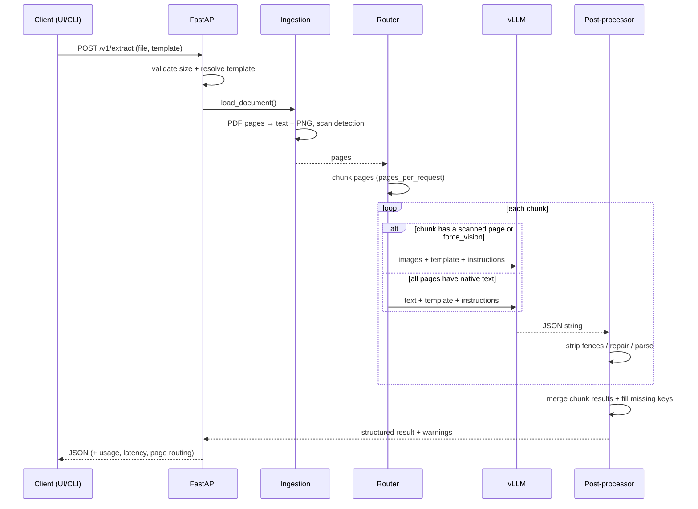

# Architecture

## Goals

1. **Correct extraction**, not just OCR: schema-guided output, repaired and shaped.
2. **Cheap where possible**: digital PDFs are sent as text, scans as images.
3. **Operable**: stateless API, separate GPU service, health/readiness probes.
4. **Testable without a GPU**: the inference boundary is a small protocol.

## Request flow

## Components

### `core/document.py` — ingestion

- Detects PDF vs image from magic bytes (not just the extension).
- Renders every PDF page with PyMuPDF at `dpi` (default 200). No Poppler/system
  dependencies.
- Keeps the native text layer when it has at least `native_text_min_chars`
  characters; otherwise the page is marked `is_scanned`.
- Normalises images: EXIF rotation, RGB, downscale above 3200 px.
- Caps documents at `max_pages` and reports truncation as a warning.

### `core/pipeline.py` — orchestration

- **Routing rule**: if any page in a chunk is scanned (or `force_vision` is set),
  the whole chunk is sent as images. Otherwise, the chunk is sent as text with
  `<page number="...">` markers. This keeps page order unambiguous.
- **Chunking**: `pages_per_request` (default 8) bounds prompt size and output
  length. vLLM batches internally, so chunks are processed sequentially.
- **Merging**: `merge_structured_results` recursively merges objects, concatenates
  arrays (e.g. line items across pages), and keeps the first non-null scalar.
- **Warnings over failures**: a single unparseable chunk does not fail the whole
  document unless every chunk fails.

### `core/client.py` — inference backends

- `VLLMClient`: async `httpx`, retries on 429/5xx with exponential backoff,
  base64 data URLs for images.
- NuExtract options are passed as **`chat_template_kwargs`**: `template`,
  `instructions`, `enable_thinking`, `mode` (`markdown`, `template-generation`).
- `TransformersClient`: lazy in-process fallback behind the same protocol.

### `core/templates.py` — contract with the model

- Loads bundled templates from `configs/templates/*.json`.
- Converts JSON Schema / Pydantic schemas (handles `$ref`, `anyOf`, enums,
  formats, arrays, nested objects).
- Validates template shape before spending GPU time.
- `ensure_template_shape` fills missing keys with `null`/`[]` and returns warnings,
  so clients always receive a stable contract.

### `core/postprocess.py` — trust boundary

The model is not trusted to emit perfectly valid JSON. We:

1. strip Markdown code fences;
2. extract the first balanced JSON object/array (string/escape aware);
3. fall back to `json-repair`;
4. merge chunks;
5. complete the template shape.

## Design decisions

| Decision | Rationale | Trade-off |
| --- | --- | --- |
| Separate vLLM service | GPU isolation, batching, independent scaling | extra network hop |
| Text-first routing | cheaper prompt, exact characters, less OCR drift | layout lost on text-only path |
| Render all pages | one code path for scans, previews, markdown | CPU + memory for large PDFs |
| Per-chunk merging | handles long documents and context limits | cross-page reasoning is weaker |
| Fill missing keys | stable API for downstream consumers | can hide genuine model failures (warnings are returned) |
| Warnings over hard failures | one bad page shouldn't lose a 20-page document | partial results need review |
| Template registry on disk | versioned, reviewable, no DB | no per-tenant templates yet |

## Scaling model

- The API is stateless: scale replicas behind a load balancer.
- vLLM throughput is GPU-bound; tune `--max-num-seqs`,
  `--gpu-memory-utilization`, `--max-model-len`.
- For long documents, vertical scaling (bigger GPU / more KV cache) matters more
  than more API replicas.
- Model weights should live on a persistent volume or be baked into the image for
  fast cold starts.

## Security posture (current)

- File size and page caps; MIME/magic-byte validation.
- No URL fetching: documents must be uploaded.
- Model output is treated as untrusted text; Streamlit HTML rendering is opt-in.
- **Not included yet**: authentication, rate limiting, PII redaction, audit logs,
  virus scanning. Do not expose the demo publicly as-is.
